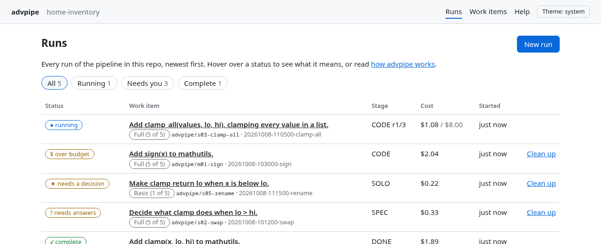
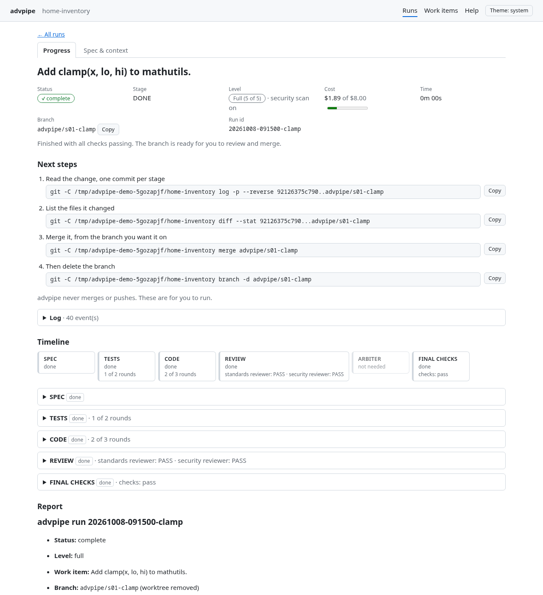
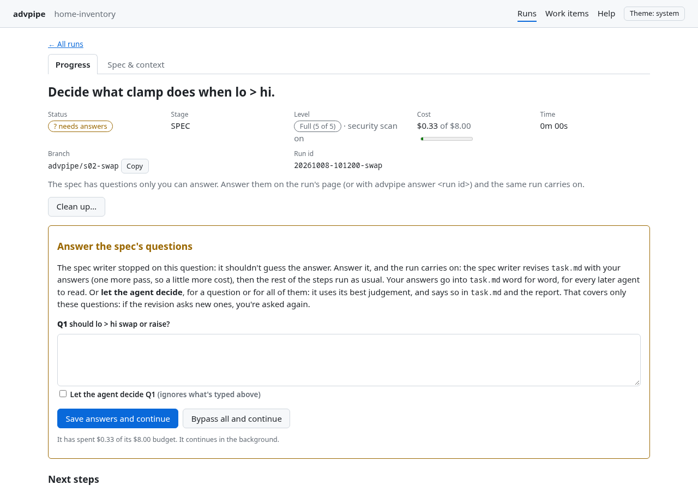
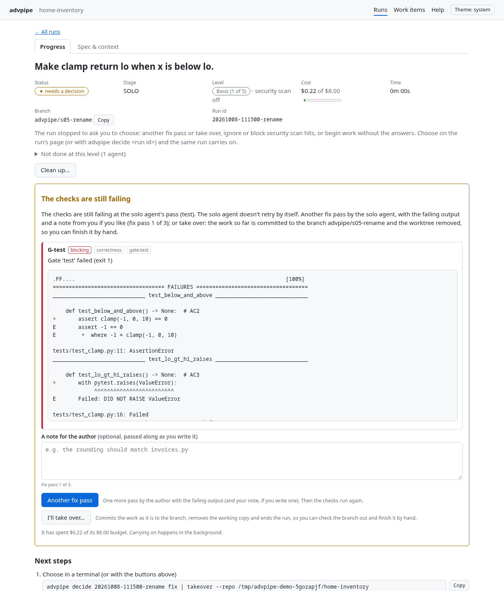
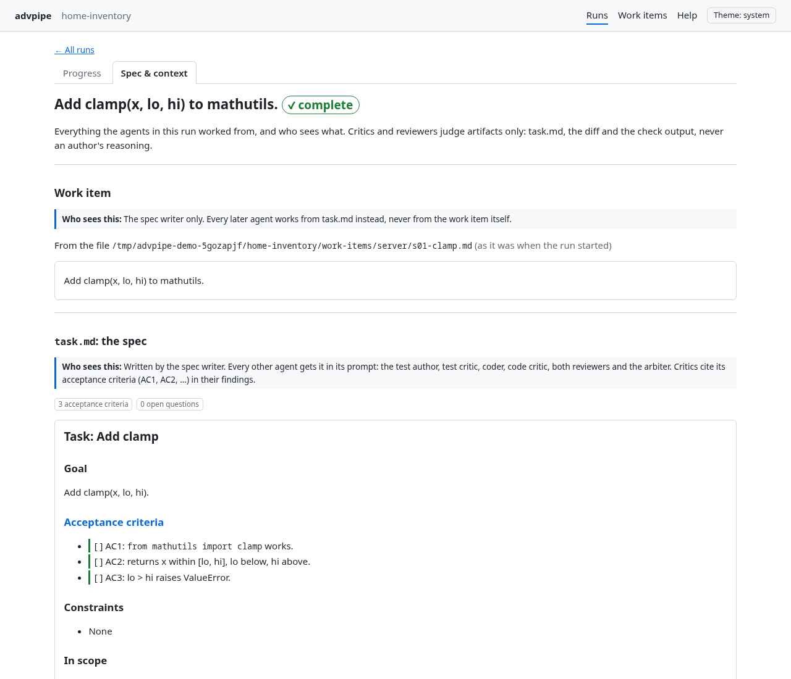
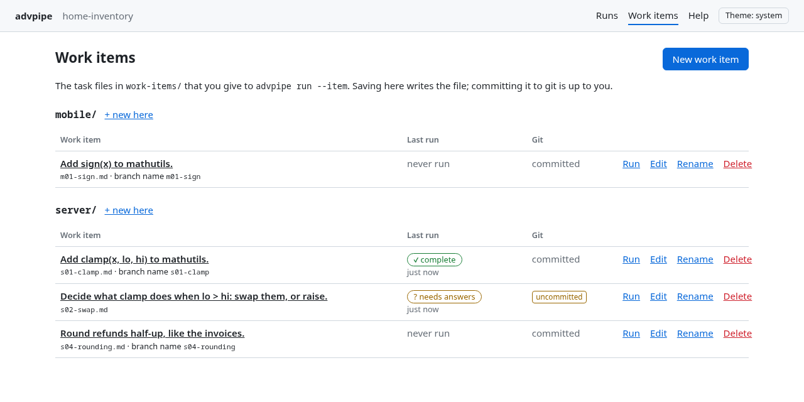
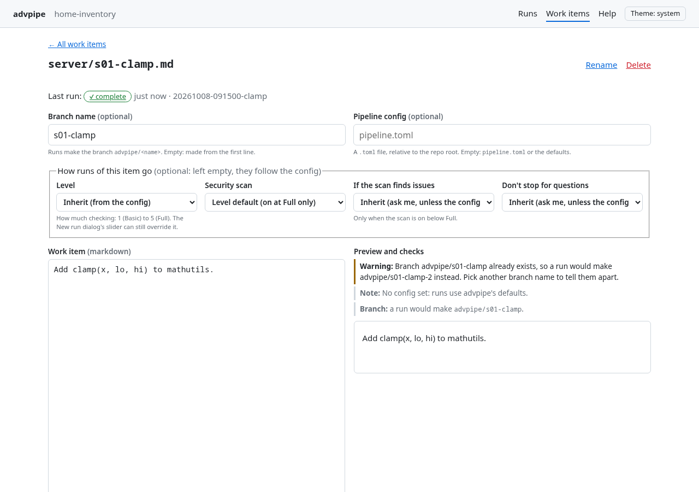
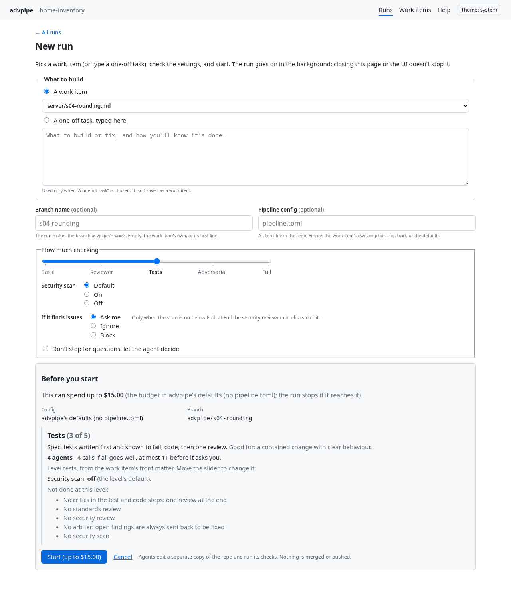
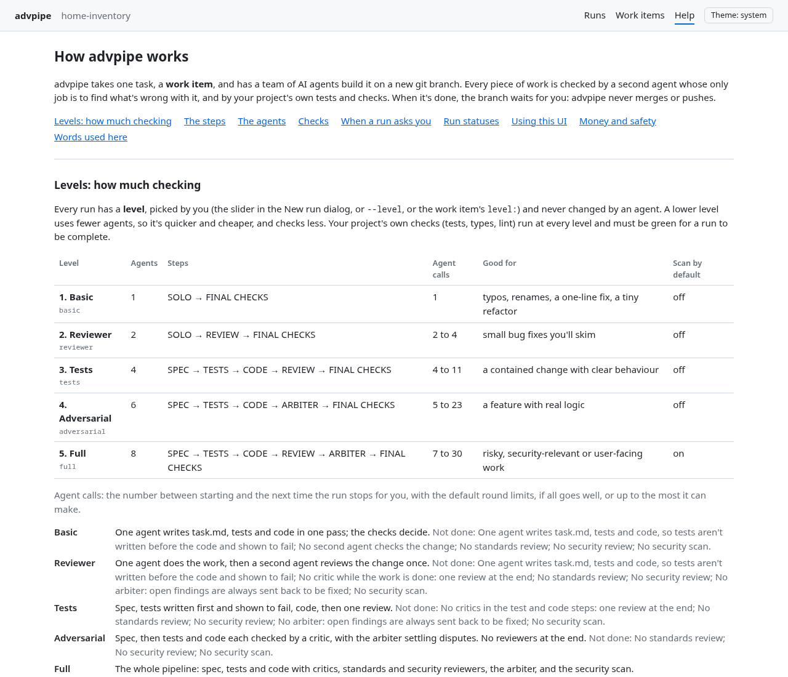
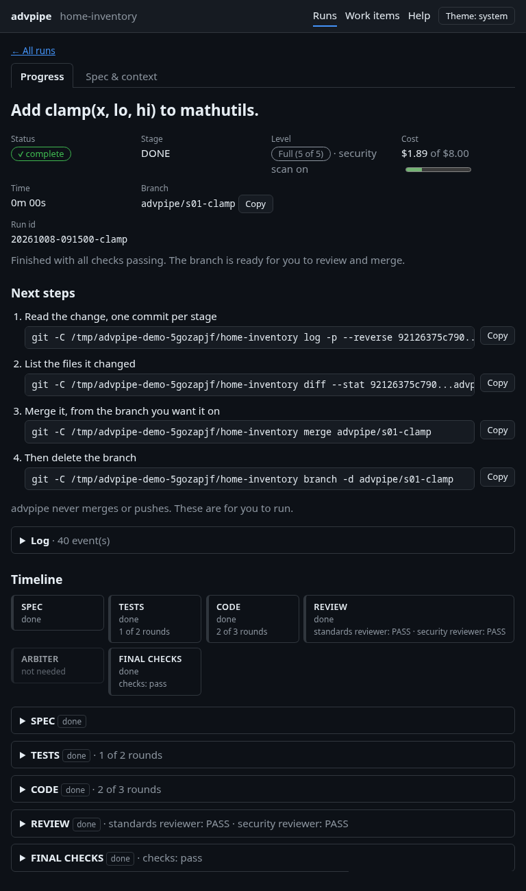

# advpipe

**Hand it a coding task. Get back a git branch with tests, an implementation, and a review
report, produced by AI agents that check each other's work.**

```sh
advpipe run --repo ~/code/myproject "add a clamp(x, lo, hi) function to mathutils"
```

```
20261008-025103-397075  complete  $0.41  advpipe/add-clamp-x-lo-hi-function
  report: ~/code/myproject/.advpipe/runs/20261008-025103-397075/report.md
```

---

- [What is this?](#what-is-this)
- [How it works (the short version)](#how-it-works-the-short-version)
- [Requirements](#requirements)
- [Install](#install)
- [Quick start](#quick-start)
- [A worked example](#a-worked-example)
- [Reviewing the result](#reviewing-the-result)
- [Using the web UI](#using-the-web-ui)
- [Commands](#commands)
- [Configuration](#configuration)
- [What it costs](#what-it-costs)
- [When *not* to use it](#when-not-to-use-it)
- [Safety](#safety)
- [Using it inside Claude Code (no Python)](#using-it-inside-claude-code-no-python)
- [Run your checks after every edit (optional hook)](#run-your-checks-after-every-edit-optional-hook)
- [Troubleshooting](#troubleshooting)
- [FAQ](#faq)
- [Developing advpipe](#developing-advpipe)

---

## What is this?

When you ask a single AI agent to write code, it marks its own homework: it writes the code,
decides it looks fine, and tells you it's done. advpipe doesn't trust that. It splits the job
across several agents with different roles, and makes them **check each other**:

- one agent writes a precise spec with acceptance criteria
- one writes tests from the spec *before any code exists*, and another tries to poke holes in
  those tests
- one writes the code, and another hunts for concrete bugs in it
- two reviewers look at the finished change, one for code quality and one for security
- if agents disagree, an arbiter settles it

Real checks (your test suite, type checker, linter) run between every step, and **a failing
check always wins over an agent's opinion**.

At the end you get a **git branch** with one commit per stage and a **report**. advpipe never
merges, pushes, or opens pull requests. You review the branch and decide.

It's built on the [Claude Agent SDK](https://code.claude.com/docs/en/agent-sdk) and uses Claude
models.

## How it works (the short version)

```
your task
   │
   ▼
 1. Spec        writes task.md: goal, acceptance criteria (AC1, AC2, ...), scope, open questions
   │            (if a question needs a human answer, stops here for you to answer, before
   │            any code; then revises task.md with your answers and carries on)
   ▼
 2. Tests       test author ⇄ test critic           up to 2 rounds
   │            check: the new tests must exist and must FAIL (nothing is implemented yet)
   ▼
 3. Code        coder ⇄ code critic                 up to 3 rounds
   │            check: tests, type checker and linter all pass
   ▼
 4. Review      standards reviewer + security reviewer, in parallel
   │
   ▼
 5. Arbiter     only if disagreements or problems remain: rules "fix" or "dismiss" on each
   │
   ▼
 6. Done        complete → a branch ready for your review
                otherwise → "needs_human", with the open problems listed in the report
```

Some rules the tool enforces in code, not just by asking the agents nicely:

- **Critics can't edit files.** They don't have editing tools. They can only report problems.
- **Critics only see the work, not the author's explanation of it**, so they can't be talked
  into agreeing.
- **Problems must be specific:** a file and line, or a numbered acceptance criterion. Vague
  complaints are thrown away.
- **The coder can't change the tests.** If it tries, the change is undone and counted against
  it.
- **Everything is bounded:** limited rounds per stage, limited steps per agent, and a dollar
  budget per task.

Want the details? See [docs/ARCHITECTURE.md](docs/ARCHITECTURE.md).

### Levels: how much checking a run gets

Every run has a **level**. The default, **Full**, is the pipeline above. Lower levels drop
agents (never checks: tests, types and lint must pass at every level) to spend less on smaller
changes:

| # | Level | Steps | Agents | Good for |
|---|---|---|---|---|
| 1 | **Basic** | one agent writes task.md, tests and code → final checks | 1 | typos, renames, a one-line fix |
| 2 | **Reviewer** | Basic, then one review by a second agent | 2 | small bug fixes you'll skim |
| 3 | **Tests** | spec → tests (shown to fail) → code → one review → final checks | 4 | a contained change with clear behaviour |
| 4 | **Adversarial** | spec → tests ⇄ critic → code ⇄ critic → arbiter → final checks | 6 | a feature with real logic |
| 5 | **Full** | everything above, plus the standards and security reviewers and the security scan | 8 | risky, security-relevant or user-facing work |

All five levels can be run ([docs/LEVELS_PLAN.md](docs/LEVELS_PLAN.md) has the design). At
**Basic**, one agent (the `solo` agent) writes `task.md`, then the tests and the code, in one
pass, and runs the checks; it doesn't retry by itself. If anything blocks it, it writes only
the blocking questions in `task.md` and stops, and you answer them as at any level. At
**Reviewer**, a second agent (the code critic) then reviews the change once, and the solo agent
gets one pass at what it found. Basic and Reviewer don't write the tests before the code, which
is the price of one agent; the checks still decide. At **Tests**, the test author and the coder each loop on the
checks alone (no critic), up to the same round caps; then the code critic reviews the whole
change once. Anything still open after a stage's cap, or blocking in that review, goes back to
the author for one final pass (there's no arbiter, so nothing is dismissed), and the checks
decide. `advpipe levels` prints this table for your config, with the
number of agent calls each level makes. Pick a level with `--level`, `level:` in a work item's
front matter, or `[pipeline] level` in `pipeline.toml` (in that order of precedence).

The **security scan** (semgrep by default) is its own switch: on by default at Full only. Turn
it on or off for a run with `--security-scan` / `--no-security-scan` (or `security_scan:` in
front matter, or `[pipeline] security_scan`). Below Full there's no security reviewer to triage
its hits, so the run asks you the first time the scan fails ([decision
points](#when-a-run-stops-and-asks-you)): **ignore** the hits (they're recorded as a minor
finding, "ignored by you") or **block** (they count like a failing test: the author gets them
and must clear them). Your choice sticks for the rest of the run. To decide up front, use
`--scan-failures ignore|block`.

Which of the design rules each level keeps:

| Rule | Basic | Reviewer | Tests | Adversarial | Full |
|---|---|---|---|---|---|
| 1. Orchestrator is code | ✔ | ✔ | ✔ | ✔ | ✔ |
| 2. Tests before code (test author sees `task.md` only) | ✘ one agent | ✘ one agent | ✔ | ✔ | ✔ |
| 3. One writer at a time; reviewers read-only | ✔ (one writer) | ✔ | ✔ | ✔ | ✔ |
| 4. Critics get artifacts, not reasoning | n/a | ✔ | ✔ | ✔ | ✔ |
| 5. Every loop bounded | ✔ | ✔ | ✔ | ✔ | ✔ |
| 6. Critics may PASS; grounded findings | n/a | ✔ | ✔ | ✔ | ✔ |
| 7. Failed gate = blocking finding | ✔ | ✔ | ✔ | ✔ | ✔ |

## Requirements

- **Python 3.11 or newer**
- **git**
- **Access to Claude** through the Claude Agent SDK: an Anthropic API key
  (`ANTHROPIC_API_KEY`) or a signed-in Claude Code installation. See the
  [Agent SDK docs](https://code.claude.com/docs/en/agent-sdk) for the options.
- **A git repository to work on**, ideally with tests. advpipe works best on projects with a
  test suite and a quick way to run it.
- *Optional:* [semgrep](https://semgrep.dev) for the security scan. Without it, the security
  reviewer works from the code changes alone, and the report says so.

**Windows:** runs, `--detach` and the web UI work. `advpipe cancel` (and Cancel in the UI)
stops a run at once rather than at its next safe point; it can still be resumed. See
[docs/WINDOWS_PLAN.md](docs/WINDOWS_PLAN.md).

## Install

advpipe isn't on PyPI. Install it from source:

```sh
git clone <this-repo-url> advpipe
cd advpipe
python -m venv .venv
source .venv/bin/activate        # Windows: .venv\Scripts\activate
pip install -e .
advpipe --help
```

With [uv](https://docs.astral.sh/uv/): `uv venv && uv pip install -e .`

## Quick start

1. **Commit or stash your work** in the project you want to change. advpipe starts from your
   current commit, and uncommitted changes aren't included.

2. **Tell advpipe how to check your project.** Create `pipeline.toml` in the project root (copy
   [`pipeline.example.toml`](pipeline.example.toml)) and set the commands that run your tests,
   type checker and linter:

   ```toml
   [gates]
   test  = ["pytest", "-q"]
   types = ["mypy", "."]
   lint  = ["ruff", "check", "."]
   ```

   If your project doesn't use one of these, set it to `[]` to skip it. Then check the commands
   work, before spending anything on agents:

   ```sh
   advpipe gates --repo path/to/project
   ```

3. **Run it:**

   ```sh
   advpipe run --repo path/to/project "describe the change you want"
   ```

   Describe the change the way you'd write a ticket for a colleague. The spec writer turns it
   into precise acceptance criteria. A typical small task takes a few minutes.

   For anything longer than a sentence, write it in a markdown file and pass the file:
   `advpipe run --repo path/to/project --item work-items/s03-stock.md` (see
   [work-item files](#work-item-files)).

4. **Read the report** (its path is printed at the end) and **review the branch** (see
   [Reviewing the result](#reviewing-the-result)).

## A worked example

Take a tiny Python package, `mathutils`, with `mean()` and `safe_div()`, a pytest suite, mypy
and ruff. We ask for a new function:

```sh
advpipe run --repo ./mathutils "add a clamp(x, lo, hi) function"
```

Here's what happened in a real run:

**1. Spec.** The spec writer read the package and its `CLAUDE.md` conventions, then wrote
`task.md` with acceptance criteria such as:

```markdown
- [ ] AC2: When `lo <= x <= hi`, `clamp(x, lo, hi)` returns `x`
- [ ] AC5: Boundaries are inclusive: `clamp(0, 0, 10) == 0` and `clamp(10, 0, 10) == 10`
- [ ] AC8: If `lo > hi`, raises `ValueError` whose message contains both "lo" and "hi"
- [ ] AC10: If `x` is NaN, the result is NaN
```

It picked sensible answers to ambiguous points ("lo > hi raises rather than swapping") and
listed them under *Open questions*. None was marked `BLOCKING:`, so the run continued.

**2. Tests.** The test author wrote `tests/test_clamp.py`, with tests for every acceptance
criterion. advpipe ran pytest and confirmed the new tests **failed**
(`ImportError: cannot import name 'clamp'`), so they really test the new feature. The test
critic returned PASS, with one minor note.

**3. Code.** The coder implemented `clamp` in `mathutils/core.py` and exported it. advpipe
checked that no test file had been touched, then ran pytest, mypy and ruff, and all passed.
The code critic found nothing blocking.

**4. Review.** The standards and security reviewers both returned PASS.

**5. Result:**

```
20261008-025103-397075  complete  $0.41  advpipe/add-clamp-x-lo-hi-function
```

```sh
$ git log --oneline main..advpipe/add-clamp-x-lo-hi-function
1305504 advpipe: implementation
1cc1e52 advpipe: tests
9ebc6ff advpipe: spec (task.md)
```

The report's cost table showed where the money went. Writing the tests (author plus critic)
was the most expensive part, and the spec was next.

## Reviewing the result

Every run leaves a branch and a report. You're the final reviewer. The branch is named after
the task, e.g. "add a clamp(x, lo, hi) function" becomes `advpipe/add-clamp-x-lo-hi-function`, or
you choose it with `--name`. The final summary and the report both show it.

```sh
advpipe report <run-id> --repo path/to/project     # read the report
git -C path/to/project log -p main..advpipe/<branch> # read the change, stage by stage
git -C path/to/project merge advpipe/<branch>       # accept it
```

**What's in the report:**

| Section | Meaning |
|---|---|
| **Level** | The run's level, how many agents it used, whether the security scan was on, and a list of what that level doesn't do ("Not done at this level"). A `full` run with the scan on just says `full`. |
| **Status** | `complete`: all checks pass and no blocking problems are open. `needs_human`: something needs you (see below). `budget_exceeded` or `error`: the run stopped early and can usually be [resumed](#commands). |
| **Rounds used** | How many back-and-forth rounds each stage needed. Many rounds is a hint to look closer. |
| **Open blocking findings** | Problems that weren't resolved. Empty on a `complete` run. |
| **Minor findings** | Non-blocking suggestions that were deliberately not acted on. Worth skimming. |
| **Arbiter rulings** | Which disputes were settled and why. |
| **Questions and answers** | Each blocking question, the pass that asked it, and its answer. Answers the agent chose because you picked Bypass are marked "agent's best judgement" with the agent's reason. |
| **Decisions** | Every time the run stopped to ask you (failing checks, security scan hits, *Begin work?*): what it asked, what you chose and your note, and, if you took over, that the branch has the work as it was. Security scan hits you ignored are also under Minor findings, marked "ignored by you". |
| **Cost by stage** | Agent calls, dollars and share of the total for each stage. |
| **Notes** | E.g. "security scanner not run", or that a run was resumed. |

**If the status is `needs_human`**, the open findings say why. Common cases:
- **The spec had blocking questions.** Answer them with
  [`advpipe answer <run-id>`](#advpipe-answer) (or on the run's page in the web UI), and the
  same run carries on: the spec writer revises `task.md` with your answers, then tests, code
  and review run as usual.
- **Checks still failed after everything the level does on its own** (the stage's rounds, the
  arbiter's rulings and a final fix pass; at Basic and Reviewer, right after the solo agent's
  pass). The run stops and asks you: another fix pass, or take over. See
  [When a run stops and asks you](#when-a-run-stops-and-asks-you).
- **The security scan reported issues** below Full: ignore them or block. Same section.
- **The spec is still blocked after its last pass:** *Begin work?*, same section.

### When a run stops and asks you

Some stops need a person's call, so the run stops (status `needs_human`), leaves its work
exactly as it is, and asks. There are three, and a run never makes the choice itself:

| It asks | When | Your choices |
|---|---|---|
| **Failing checks** | tests, types or lint are still red after everything the level does by itself | `fix`: one more pass by the stage's author, with the failing output and a note from you if you give one (up to `max_fix_passes`, default 3, per run) · `takeover`: advpipe commits the work to the branch ("work in progress, handed over") and removes the working copy, so you can finish it by hand |
| **Security scan hits** (below Full) | the scan failed and the policy is `ask` | `ignore`: carry on, hits recorded as minor findings "ignored by you" · `block`: treat the hits like a failing test |
| **Begin work?** | the spec is still blocked after its last pass | `begin`: the agent decides those questions, and any later one · `stop`: end the run |

The summary line, `advpipe status <run-id>` and the report show what's asked and the command for
each choice. A foreground `advpipe run` in a terminal asks you right there (or "later", which
leaves the run waiting, as a `--detach`ed run does). Otherwise:

```sh
advpipe decide <run-id> fix --note "keep the public signature"
advpipe decide <run-id> takeover
```

See [`advpipe decide`](#advpipe-decide). In the web UI the run shows as *needs a decision*, with
a panel on its page for each of these (see [A run's page](#a-runs-page)).

**Merging:** if you're happy with the branch, merge it the way you normally would. You may want
to delete `task.md` first, or keep it as documentation.

**Cleaning up:** after a `complete` run the working copy is removed automatically, so only the
branch is left. Delete the branch with `git branch -D advpipe/<branch>` when you're done. For a
run that failed or that you don't want, `advpipe clean <run-id>` removes its working copy and
branch (see [`advpipe clean`](#advpipe-clean)). Run logs live in `.advpipe/` in your project.
That folder is excluded from git automatically, and you can delete it at any time.

## Using the web UI

advpipe has an optional local web UI for people who'd rather not live in the terminal. It shows
the same files the CLI writes, and its buttons run the same `advpipe` commands, so you can
switch between the two at any time.

```sh
pip install -e '.[ui]'                     # once
advpipe ui --repo ~/code/myproject         # prints a link with a token: open it
```

It only listens on this machine and needs the token in that link; see
[`advpipe ui`](#advpipe-ui) for the options. **Help** in the top bar explains the pipeline in
plain words: the steps, the agents and what each one sees, the checks, and what each run status
means and what to do about it.



### Runs

The **Runs** page lists every run in the repo, newest first, with its status, stage and round,
cost (against the budget while it's running) and age.
It refreshes itself every few seconds, so runs started from a terminal (or with `--detach`) show
up and move along by themselves. Hover over a status to see what it means. Filters show all
runs, running ones, ones that need you (`needs you`, `needs answers`, `needs a decision`,
`stopped`, `over budget`, `error`), or complete ones. `needs answers` is a run whose spec stopped
on blocking questions: answer them on its page. `needs a decision` is a run waiting at a
[decision point](#when-a-run-stops-and-asks-you): choose on its page. `handed over` and `ended`
are runs you took over or stopped; they need nothing more. Each row shows the run's **level**
(`Basic (1 of 5)` ... `Full (5 of 5)`).

### A run's page



Click a run to open its page:

- **Header:** status (hover for what it means), stage, cost against the budget, time, and the
  branch with a copy button. If the run needs you, *What's left open* lists the findings.
- **Level:** the run's level, whether the security scan is on, and (folded away) what that level
  doesn't do.
- **Answer the spec's questions:** for a run that *needs answers*, a form with a box per
  blocking question. *Save answers and continue* runs `advpipe answer ... --detach`: the same
  run carries on in the background, starting with the spec writer (at Basic and Reviewer, the
  solo agent) revising `task.md` with your answers (see [`advpipe answer`](#advpipe-answer)).
  Each question also has a **Let the agent decide** box (`--bypass=Q2`), and **Bypass all and
  continue** hands every question to the agent (a ticked box, or that button, wins over text
  left in an answer box). The agent's answers show with an *agent's best judgement* badge and
  its reason, on the SPEC (or SOLO) step and on the Spec & context tab. The SPEC step shows each
  spec pass with the questions it asked and the answers.
- **Decision panel:** for a run *needing a decision*, what's asked, the failing output or scan
  hits, and the choices, which run `advpipe decide <id> CHOICE --detach`: *Another fix pass*
  (with a note box, "fix pass N of 3") or *I'll take over*; *Ignore and continue* or *Block* for
  scan hits; *Begin work* or *Stop here* at the spec-pass limit. *I'll take over* and *Stop here*
  end the run, so they open a confirmation page that says exactly what happens first. A run you
  took over shows as *handed over*, with the commands to check its branch out.
- **Actions:** buttons for what can be done with the run as it is now (see *Starting and
  managing runs* below): *Cancel run* while it's running; *Resume* for a stopped, failed or
  over-budget run; *Clean up…* for any run that isn't running or complete.
- **Next steps:** the commands to run next, each with a copy button. For a complete run:
  read the change, list the files, merge, delete the branch. Otherwise: resume, cancel or
  clean up. The UI never merges: those commands are for you to run.
- **Log:** the run's progress lines. While the run is going, new lines appear as they happen,
  and the header and timeline update by themselves.
- **Timeline:** the steps of the run's level (all of SPEC → TESTS → CODE → REVIEW → ARBITER →
  FINAL CHECKS at Full; SOLO → FINAL CHECKS at Basic), each marked done, in progress, stopped
  here, not yet, or not needed. Open a step to see its rounds: what the author replied, the check
  results (with output), the exact diff the critic judged, and the critic's verdict with its
  findings (a level without critics says "No critic at this level"). SPEC and SOLO also show
  `task.md`; ARBITER shows its rulings; a fix pass you asked for, and each decision you made, are
  panels in the step where the run stopped.
- **Report:** `report.md`, once the run has finished.





### Spec & context



The run page has a second tab, **Spec & context**: everything the agents worked from, each
with a note on which agents see it (critics and reviewers only ever see `task.md`, the diff and
check output, never an author's reasoning):

- **Work item:** the text the run started from, and the file it came from (`--item`).
- **`task.md`:** the spec, with its acceptance criteria and open questions highlighted, and
  `BLOCKING` questions (the ones that stop the run for you) in red.
- **Config and checks:** the budget, round caps and turn limit the run used, each check's
  command (or "off"), and the recorded `config.json`.
- **Standards doc:** the `CLAUDE.md` (or whatever `paths.standards_doc` names) the standards
  reviewer was given, read from the run's branch.
- **Role prompts:** all eight, with each role's model, tools, and what goes into its prompt.

A file the run hasn't written (yet) says so, and what that means.

### Work items



The **Work items** tab lists the `.md` files in `--items-dir`, grouped by folder. Each shows its
first line, its branch name and config if the front matter sets them, its last run's status
(for runs started with `--item`; click it to open the run), and whether git has it: *not in
git*, *uncommitted* (changed since the last commit), *ignored*, or committed.

- **New** and **Edit** open an editor: the file name (new items only; folders are made as
  needed and `.md` is added), the **branch name** and **pipeline config** (saved as front
  matter), how runs of this item go (**level**, **security scan**, **if the scan finds issues**
  and **don't stop for questions**: each a drop-down whose first option, *Inherit*, leaves the
  key out of the front matter so the config decides), and the markdown body, with a live
  preview. Checks run as you type: an empty body, a field with a line break or a setting `advpipe
  run` wouldn't accept can't be saved; a config file that's missing or has errors, or a branch
  that already exists, gets a warning.
- **Save** writes the file and nothing else; committing it is up to you. If nothing changed,
  the file is left exactly as it was. If the file was changed on disk after you opened it
  (say, in your text editor), saving is refused so those changes aren't overwritten.
- **Rename** moves a file, also into another folder. **Delete** asks first, and says whether
  git still has a copy. Runs keep their own copy of the work item, so neither affects them.
- Only `.md` files inside the folder can be opened or changed: paths with `..`, absolute paths,
  hidden files, and symlinks that lead out of the folder are refused.
- **Run** (in the list and the editor) and **Save & run** (in the editor) open the New run
  dialog for that item. They never start anything by themselves.



### Starting and managing runs



Every action runs the same advpipe command you'd type, in the background, so the run carries
on if you close the page or stop the UI.

- **New run** (on the runs page, or *Run* on a work item) opens a dialog: pick a work item, or
  type a one-off task (it isn't saved), and optionally a **branch name** and **config** that
  override the item's front matter. **How much checking** is a slider from *Basic* to *Full*
  (the [levels](#levels-how-much-checking-a-run-gets)), starting at the level the work item's
  front matter, else the config, else Full gives; under it, the **security scan** (*Default*,
  *On*, *Off*), what to do **if it finds issues** below Full (*Ask me*, *Ignore*, *Block*) and
  **Don't stop for questions** (Bypass up front, off by default: the agent answers every blocking
  question itself). Moving the slider updates the summary under the form: the level's name,
  its agents, how many agent calls it makes before it asks you, the scan setting, and what that
  level doesn't do. Before you start, the summary also shows the branch the run will make,
  which config it uses, problems (a missing or invalid config, an item that doesn't parse) and
  **"This can spend up to $X"**: the config's `budget_usd_per_task`. *Start* runs
  `advpipe run --item FILE --level LEVEL --detach` (or `advpipe run --detach ... -- "TASK"`),
  adding `--security-scan`/`--no-security-scan`, `--scan-failures` and `--bypass-questions` only
  for choices you made, and opens the run's page. If the config changed after the dialog showed
  its budget, or the level, scan, scan policy or Bypass you submitted isn't what the summary
  showed a moment ago, it refuses and shows the new one, so a run never starts on settings you
  didn't see. A run that fails before it gets going
  (say, its config can't be read) shows its output there instead.
- **Cancel run** asks first, then runs `advpipe cancel`: the run stops at its next safe point
  and can be resumed.
- **Resume** runs `advpipe resume --detach`. Its budget field is the run's new *total* budget
  (it has to be more than it has spent); empty keeps the current one. For a run that ran out
  of budget, a bigger one is filled in for you.
- **Clean up…** opens a page saying what would be removed (the working copy, the branch, and
  how many of its commits no other branch has), with options to delete those commits anyway
  (`--force`) and the run's log (`--logs`). It then runs `advpipe clean`. The runs list has a
  *Clean up* link on every run it applies to.
- A button only shows when the action makes sense for the run's status, and the UI checks
  again when you click: if the run moved on in the meantime, it says so instead. When advpipe
  itself refuses (say, a branch with commits only it has), its message is shown.
### Help, themes and keyboard



- **Help** (top bar) is the pipeline in plain words. Its tables come from the code, so the round
  limits, budget, models, and the levels (agents, steps, call counts, what each drops, and the
  design rules level by level) it quotes are advpipe's real ones. It also explains when a run
  asks you, and every status.
- **Theme:** the UI follows your system's light or dark setting. The *Theme* button in the top
  bar switches between system, dark and light; the choice is remembered in this browser.
- **Keyboard:** everything works without a mouse. The first <kbd>Tab</kbd> on a page offers
  *Skip to content*; every link, button and fold-out panel shows a clear focus ring.
- **Smaller screens:** pages fit down to tablet width (768 px). Wide content, like diffs and
  commands, scrolls sideways inside its box instead of stretching the page.



## Commands

### `advpipe run`

Run one or more tasks.

```sh
advpipe run "task description" [--repo PATH] [--config FILE] [--name NAME] [--keep-worktree]
advpipe run --item work-items/s03-stock.md [--repo PATH] [--detach] [--level adversarial]
advpipe run --from-file tasks.txt --parallel 3 [--repo PATH]
```

- `--repo`: the project to work on (default: current directory). Must be a git repository.
- `--config`: config file (default: `<repo>/pipeline.toml`, falling back to built-in defaults).
- `--item FILE`: read the task from a markdown file. The file can set defaults for `--name` and
  `--config` in a front-matter block (see [work-item files](#work-item-files)). Prefer this to
  `"$(cat FILE)"`, which silently passes an empty task if the file doesn't exist.
- `--from-file`: run each non-empty line of a file as a separate task. Lines starting with `#`
  are skipped.
- `--parallel N`: with `--from-file`, run up to N tasks at once. Each task gets its own branch,
  working copy and budget, so they don't interfere.
- `--name NAME`: name the branch `advpipe/NAME`. By default the name comes from the task's first
  line, with filler words dropped and cut to 40 characters (`advpipe/fix-refund-rounding-bug`).
  If that branch already exists, `-2`, `-3`, ... is appended.
- `--level LEVEL`: how much checking, by name or number: `basic` (1), `reviewer` (2), `tests`
  (3), `adversarial` (4) or `full` (5). See [levels](#levels-how-much-checking-a-run-gets).
  Default: the work item's front matter, else `[pipeline] level`, else `full`.
- `--security-scan` / `--no-security-scan`: run the security scan or not. Default: the work
  item's front matter, else `[pipeline] security_scan`, else on at `full` only.
- `--scan-failures ask|ignore|block`: below `full`, what a failing security scan means: `ask`
  (the default: the run stops and asks you the first time), `ignore` (record the hits as a minor
  finding "ignored by you" and carry on) or `block` (treat them like a failing test).
- `--bypass-questions` / `--no-bypass-questions`: never stop for blocking questions; the agent
  answers them itself with its best judgement (see [Bypass](#bypass-let-the-agent-decide)).
  Default: the work item's front matter, else `[pipeline] bypass_questions`, else off. Rarely
  the right choice.
- `--keep-worktree`: don't delete the working copy after a successful run.
- `--quiet` / `-q`: don't print live progress.
- `--detach`: run in the background. advpipe prints the run id and returns at once; the run
  keeps going even if you close the terminal. Its progress goes to
  `.advpipe/runs/<run-id>/console.log`. Follow it with `advpipe status <run-id>`, stop it with
  `advpipe cancel <run-id>`. Works with a single task (a description or `--item`).

Give exactly one of a task description, `--item` or `--from-file`.

While it runs, advpipe prints timestamped progress to stderr: each stage, each agent starting
and finishing (with its cost and the run total so far), check results, critic verdicts and
arbiter rulings. With several tasks, each line is prefixed with `[item N]`. When the run
finishes, a one-line summary per task goes to stdout, so `advpipe run ... > result.txt` captures
just the summary. Below `full`, or with the scan not at its level's default, the line ends with
the level, e.g. `[adversarial]` or `[full, no scan]`; a `full` run with the scan reads as it
always has. The same progress is also written, one JSON object per line, to
`.advpipe/runs/<run-id>/events.jsonl` (see [the run directory](docs/ARCHITECTURE.md#persistence-resume-and-locking)).

Exit code: 0 if every task completed, 1 otherwise, 130 if it was interrupted (Ctrl-C or
`advpipe cancel`). With `--detach`, 0 once the run has started.

#### Work-item files

A work item is a markdown file. Its text is the task. An optional front-matter block at the very
top sets defaults for that task:

```markdown
---
name: s03-stock
config: pipeline.server.toml
level: adversarial
---
Add stock level changes with a change history...
```

- `name`: the branch name, as with `--name` (here `advpipe/s03-stock`).
- `config`: the config file, relative to the repo root, as with `--config`.
- `level`: as with `--level` (a name or 1-5).
- `security_scan`: `yes` or `no`, as with `--security-scan` / `--no-security-scan`.
- `scan_failures`: `ask`, `ignore` or `block`, as with `--scan-failures`.
- `bypass_questions`: `yes` or `no`, as with `--bypass-questions` / `--no-bypass-questions`.

Only these keys are allowed, one `key: value` per line; anything else (or a value that isn't
one of the allowed ones) is an error, with the file and line, so typos don't go unnoticed. Options on the command line win over front matter. A file with no text after
the front matter is rejected. The run remembers which file it came from (`work_item_file` in
`run.json`).

### `advpipe status`

```sh
advpipe status [--repo PATH]             # list all runs
advpipe status <run-id> [--repo PATH]    # details of one run
```

Shows status, current stage and round, level and security scan, cost so far, and which
stages are finished. It also shows what you've decided: the questions with their answers (marked
when the agent answered them under Bypass), each decision you made, what the scan policy is, and
how many security scan findings you ignored. A run waiting on you shows the choices and their
commands. You can run
it in a second terminal while a run is going; `run.json` is updated after every agent call.

### `advpipe report`

```sh
advpipe report <run-id> [--repo PATH]
```

Prints the run's `report.md`.

### `advpipe answer`

```sh
advpipe answer <run-id> [--repo PATH]                    # asks each question in the terminal
advpipe answer <run-id> --answer 'Q1=raise ValueError' [--answer 'Q2=...']
advpipe answer <run-id> --template > answers.md          # then edit it, and:
advpipe answer <run-id> --file answers.md
advpipe answer <run-id> --bypass [Q2]                    # let the agent decide (all, or just Q2)
    [--no-resume] [--detach] [--budget USD] [--config FILE] [--keep-worktree] [--quiet]
```

When the spec writer marks a question `BLOCKING:` (something it shouldn't guess, such as a
product decision), the run stops at the spec with `needs_human`, before any tests or code. The
summary says so:

```
20261009-101500-ab12cd  needs_human  $0.31  advpipe/s04-refunds
  2 blocking questions. Answer them, and the run continues: advpipe answer 20261009-101500-ab12cd
```

`advpipe answer` saves your answers and resumes the same run: same branch, same budget, and
nothing redone except one more spec-writer pass, which revises `task.md` with your answers.
advpipe then adds an `## Answers` section to `task.md` with your answers word for word, so the
test author, critics and reviewers all work from them. The questions and answers also appear
in `advpipe status <run-id>` and in the report.

- **Answer every question.** Answers are all or nothing: answer each one, or Bypass it (below).
  Each answer can be up to 8,000 characters.
- **Three ways to answer:** with no options in a terminal, it asks each question in turn (one
  line each). `--answer ID=TEXT` gives one answer (repeat it). `--file` reads an answers file:
  each answer starts with a line `Q1: ...` and may go on over the following lines; lines
  starting with `#` are ignored. `--template` prints one with the questions filled in.
- `--no-resume` only saves the answers (answer again to change them); `advpipe resume <run-id>`
  or `advpipe answer <run-id>` then continues. `--detach` resumes in the background. `--budget`,
  `--config` and `--keep-worktree` work as for `advpipe resume`.
- **Bypass: let the agent decide** <a id="bypass-let-the-agent-decide"></a>. For questions you
  don't want to answer, `--bypass` lets the spec writer answer them with its best judgement.
  A bare `--bypass` covers every question you didn't answer with `--answer` or `--file`;
  `--bypass Q2` (repeat it, or `Q2,Q3`) covers just those. In an answers file, write `Q2: BYPASS`
  (exactly that word) instead of an answer, and in the terminal, leave an answer empty and
  confirm "Bypass Q2?". When the run resumes, the spec writer is called once, for those
  questions only, to give each an answer and a one-paragraph reason (it may not edit files:
  anything it changes is put back); then the usual revision pass uses them. If it gives no
  usable answer, a stand-in ("No answer given; use your best judgement and record the choice
  under Assumptions") is recorded, so the run can't stall. Agent answers are marked everywhere:
  in `task.md`'s `## Answers` section (*Answer (agent's best judgement)*, with the reason), in
  the report and in `advpipe status`. Bypass covers only the stop it was chosen at: if the
  revision asks new blocking questions, the run stops again, and you can answer or Bypass those.
  At Basic and Reviewer the solo agent answers its own questions.
  The reply itself is saved as `spec/pass-N/bypass.json` in the run directory and is never shown
  to later agents; they see only the `## Answers` section.
- **Bypass up front.** `advpipe run --bypass-questions` (or `bypass_questions: yes` in a work
  item's front matter, or `[pipeline] bypass_questions = true`) skips the stop altogether: each
  blocking question is answered by the agent as it comes up. Spec passes are still capped by
  `max_rounds_spec`; at the cap the agent's answers go into `task.md` without another
  revision, and the run goes on. A resumed run keeps this setting.
- **More questions?** The revised spec may ask a new blocking question (numbered on from the
  last one, so `Q3` after `Q1` and `Q2`); answer it the same way. A spec gets at most
  `max_rounds_spec` passes (default 3: the first and two rounds of answers). If it's still
  blocked after that, the run doesn't ask again: it asks *Begin work?*
  ([`advpipe decide`](#when-a-run-stops-and-asks-you)): `begin` lets the agent decide those
  questions, and any later one, and the run goes on; `stop` ends it (reword the work item and
  start a new run).
- It refuses a run that isn't waiting on answers, one that's running, and one whose branch was
  deleted (e.g. by `advpipe clean`). Exit codes are those of `advpipe resume`; 2 if the answers
  were refused.

### `advpipe decide`

```sh
advpipe decide <run-id> [CHOICE] [--repo PATH] [--note TEXT]
    [--no-resume] [--detach] [--budget USD] [--config FILE] [--keep-worktree] [--quiet]
```

Choose what a run does at the point where it stopped to ask you (see [When a run stops and asks
you](#when-a-run-stops-and-asks-you)). `CHOICE` is `fix` or `takeover` for failing checks,
`ignore` or `block` for scan hits, `begin` or `stop` for *Begin work?*. Without it, in a
terminal it asks; otherwise it prints the choices and exits 2.

- `fix` runs one more pass by the author of the stage that was red, with the failing checks and
  your `--note` (up to 8,000 characters, passed along as you wrote it); there's no critic
  round afterwards, the checks decide. Green: the run carries on from that stage. Red: it
  asks again. After `max_fix_passes` (default 3) fix passes, `fix` is refused: take over, or
  start a new run.
- `takeover` and `stop` end the run on the spot and print what's where (for `takeover`:
  `git switch advpipe/...`, and the checks to run). The run can't be resumed afterwards;
  `advpipe clean` follows its usual rules.
- The other choices resume the same run exactly as `advpipe resume` does (so `--detach`,
  `--budget`, `--config`, `--keep-worktree` and the exit codes are the same; `--no-resume` only
  saves the choice). The work in the working copy is kept as it was.
- It refuses a run that isn't waiting for a decision, a choice that isn't one of that
  decision's, a note on any choice but `fix`, a run being driven by a live process, and a run
  whose branch was deleted. `advpipe resume` on a run that's waiting names this command.

### `advpipe resume`

```sh
advpipe resume <run-id> [--repo PATH] [--budget USD] [--config FILE] [--quiet] [--detach]
```

Continue a run that was interrupted (Ctrl-C, crash, closed laptop), stopped by an error, or ran
out of budget. It picks up at the first stage that didn't finish; finished stages aren't redone
or paid for again. Use `--budget` to raise the limit after `budget_exceeded`; the run keeps the
new limit (it's saved in the run's `config.json`). Completed runs and `needs_human` runs can't
be resumed, except a run that stopped on blocking questions or at a decision point: answer them
with [`advpipe answer`](#advpipe-answer) or choose with [`advpipe decide`](#advpipe-decide),
which resume it for you (or use `--no-resume`, then `advpipe resume`). `--detach` resumes in the background, as with
`advpipe run --detach`: it checks the run can be resumed, prints the run id and returns.
A resumed run keeps its level and security-scan setting; a `--config` whose `[pipeline]` sets
different ones is refused.

### `advpipe cancel`

```sh
advpipe cancel <run-id> [--repo PATH]
```

Stops a running run, whether it's in another terminal or started with `--detach`. It's the same
as pressing Ctrl-C in the run's terminal: the run stops at its next safe point (when the current
agent call or check is interrupted), keeps its finished stages, and shows as `running` in
`advpipe status`. Continue it later with `advpipe resume <run-id>`. With `--from-file`, all tasks
share one process, so cancelling one cancels them all.

### `advpipe clean`

```sh
advpipe clean <run-id> [--repo PATH] [--force] [--logs]
```

Removes the working copy and the `advpipe/...` branch of a run you don't want, such as one that
failed or stopped at `needs_human`. The run's log stays (with a note) unless you pass `--logs`.

It refuses:

- **complete runs**: their branch is the result. Delete it with `git branch -D` when you're done.
- **active runs**: stop them first with `advpipe cancel`.
- **branches with commits no other branch has**, unless you pass `--force`. It shows the
  `git log` command to look at them first.

### `advpipe ui`

```sh
pip install -e '.[ui]'     # once: the web UI's extra packages
advpipe ui [--repo PATH] [--port 8765] [--items-dir work-items]
```

Serves a small web page on this machine for watching, starting and managing runs. It prints a
link like `http://127.0.0.1:8765/?token=...`: open that. See [Using the web UI](#using-the-web-ui)
for a tour.

- It reads the run files, and acts only through the advpipe commands (see
  [Starting and managing runs](#starting-and-managing-runs)). Closing it
  doesn't affect any run, including runs started from it.
- It's for this machine only: it listens on `127.0.0.1`, and every request needs the token from
  the link (it's kept in a cookie after the first visit). A new token is made each time you
  start it. `--host` with anything else is refused unless you also pass
  `--i-know-this-is-exposed`. Don't: the UI can start runs, which spend money and run
  commands.
- One repo per `advpipe ui`. To watch several repos, start one per repo on different ports.
- `--items-dir` is where your work-item files live, relative to the repo (default
  `work-items`). See [Work items](#work-items).

### `advpipe gates`

```sh
advpipe gates [--repo PATH] [--only test,types,lint,security]
```

Runs your configured checks once and prints the results. It exits with code 2 if any fail.
Handy on its own, and used by the [optional hook](#run-your-checks-after-every-edit-optional-hook).

### `advpipe levels`

```sh
advpipe levels [--repo PATH] [--config FILE]
```

Prints the five [levels](#levels-how-much-checking-a-run-gets): what each runs, its agents, how
many agent calls it makes if all goes well and at most (with your config's round caps), whether
the security scan is on by default, and what it leaves out compared with `full`. It marks your
config's default level. Read-only; no API calls.

## Configuration

Put a `pipeline.toml` in your project root. Every setting is optional; the defaults are shown.
Misspelled keys are reported as errors rather than silently ignored.

```toml
[models]
author  = "claude-opus-5-5"     # spec writer, test author, coder
critic  = "claude-sonnet-5-5"   # test critic, code critic, both reviewers
arbiter = "claude-opus-5-5"

[limits]
max_rounds_spec     = 3      # spec passes: the first, plus one per round of answers
max_rounds_tests    = 2      # test author ⇄ critic rounds
max_rounds_code     = 3      # coder ⇄ critic rounds
max_turns_per_agent = 40     # steps a single agent may take
budget_usd_per_task = 15.0   # hard stop for the whole run
gate_timeout_s      = 600    # max seconds per check command
max_fix_passes      = 3      # extra fix passes you can ask for when checks stay red

[gates]
# Commands run from the project root. [] = skip this check.
test     = ["pytest", "-q"]
types    = ["mypy", "."]
lint     = ["ruff", "check", "."]
security = ["semgrep", "--error", "--config", "auto"]   # skipped if not installed

[paths]
tests         = ["tests/"]   # files the coder is not allowed to change
standards_doc = "CLAUDE.md"  # your coding conventions, given to the standards reviewer

[pipeline]
level         = "full"       # basic | reviewer | tests | adversarial | full (or 1-5)
# security_scan = true       # leave out to use the level's default (on at full only)
scan_failures = "ask"        # below full, what a failing scan means: ask | ignore | block
bypass_questions = false     # true: the agent answers blocking questions itself, nobody is asked
```

**Tips:**
- **Gates are just commands**, so any language works: `["npm", "test"]`, `["go", "test", "./..."]`,
  `["cargo", "clippy"]`. If a tool lives in a virtualenv, give its full path, e.g.
  `[".venv/bin/pytest", "-q"]`. Note that each run happens in a fresh checkout under
  `.advpipe/worktrees/`, which won't contain untracked folders like `.venv`, so an absolute
  path is safest.
- **Write down your conventions.** The standards reviewer judges against `standards_doc`, and
  agents also read your project's `CLAUDE.md`. A few lines on naming, error handling and test
  style noticeably improve results.
- **Critics use a different, cheaper model on purpose.** A different model is more likely to
  catch the author's blind spots.

## What it costs

You pay for the Claude API usage of every agent call. A `full` run makes **at least 7 agent
calls** (spec, test author, test critic, coder, code critic, two reviewers); an `adversarial`
run at least 5 (no reviewers). `advpipe levels` shows the minimum and maximum per level. Each extra round adds two
more, and the arbiter adds one or two.

As a reference point, the [worked example](#a-worked-example) (a small, well-defined function,
every stage passing first time) cost **$0.41** and took about two minutes. Expect bigger,
vaguer or more tangled tasks to cost several times that, mostly through extra rounds and agents
reading more code. That's why there's a hard budget per task (default **$15**): the run stops
with `budget_exceeded` the moment it's crossed, and you can resume it with a higher budget if
you want it to finish.

Every report includes a per-stage cost table, so you can see where money goes on your own
projects. Lowering `max_rounds_*` or pointing `author` at a cheaper model are the main levers.

## When *not* to use it

advpipe trades money and time for confidence. That's a bad trade for:

- **Routine changes:** renames, dependency bumps, copy edits, config tweaks. Use
  `--level basic` (one agent) or `--level reviewer` (one agent plus one review), or just do it
  yourself. The checks still run.
- **Exploratory work** where you don't know what you want yet. The pipeline needs a task that
  can be pinned down to acceptance criteria.
- **Projects without a usable test command.** The whole design leans on tests as ground truth.
  Without them, it's opinions all the way down.
- **Big, multi-part features.** Split them into independent tasks and run them separately
  (maybe with `--parallel`). advpipe handles one well-scoped change per run.
- **Changes needing judgement calls only you can make**, such as product decisions or API design
  trade-offs. The spec writer will flag these as blocking questions and stop for your answers,
  which works, but you could have put the decisions in the work item in the first place.

It shines on **well-defined features and bug fixes in tested codebases**, where a second pair
of eyes catches real mistakes.

## Safety

Read this before pointing advpipe at anything important.

- **Agents run shell commands without asking.** The test author and coder can run any shell
  command (normally to run tests or inspect files), with *your* user's permissions, starting in
  the run's working copy. advpipe pre-approves their tools so runs never stall on a prompt. There is no
  sandbox. **Only use advpipe on code you trust, on a machine where that's acceptable.**
- **Your working directory is never modified.** All work happens in a separate git worktree on
  its own branch.
- **Nothing leaves your machine through git.** advpipe never pushes, merges, or opens pull
  requests.
- **Your code is sent to the Claude API** as part of the agents' work, as with any AI coding
  tool.
- **Review before merging.** The pipeline makes your review faster; it doesn't replace it.
- **The web UI is local only.** `advpipe ui` listens on `127.0.0.1` and needs the token it
  prints. It can start runs, so anyone who can use it can spend your money and run agents on
  your machine. Don't expose it to a network.

## Using it inside Claude Code (no Python)

This repository also contains a version of the pipeline that runs *inside* an interactive
[Claude Code](https://code.claude.com) session, with no install:

- `.claude/agents/`: the nine roles as Claude Code subagents (the eight pipeline roles and `solo`)
- `.claude/skills/adversarial-build/`: the procedure, as a skill

Copy both folders into your project's `.claude/` directory (or your personal `~/.claude/`),
restart Claude Code, and ask:

```
/adversarial-build add a clamp(x, lo, hi) function
```

If the spec has blocking questions, Claude asks you in the session, then has the spec writer
revise `task.md` with your answers and carries on.

The skill has the same **levels** as the CLI. Name one, the security scan, or "don't ask me
questions" in the request:

```
/adversarial-build --level basic fix the typo in the refund error message
/adversarial-build --level adversarial with the security scan: add a refund window
```

Without a level it runs `full` with the scan on. Claude never picks or changes the level, and
says once if the work item looks bigger than the one you chose. It stops and asks you, in the
session, at the same places as the CLI: blocking questions (answer them, or say **bypass** and
the agent decides, marked "agent's best judgement" in `task.md`), *Begin work?* after the third
spec pass, failing checks the level couldn't fix (another fix pass with an optional note, at
most 3, or take over), and security scan hits below Full (ignore or block). Its final summary
states the level, the scan setting, what the level didn't do, every bypassed question and every
decision you made. A usage limit inside a Claude Code session is Claude Code's own business.

The trade-off: in this version, Claude follows the procedure as instructions, so the rules are
only as reliable as the model's instruction-following. The `advpipe` CLI enforces them in code.
Use the skill for quick interactive work, and the CLI when you want the guarantees.

## Run your checks after every edit (optional hook)

Separately from the pipeline, you can have Claude Code run your checks every time it edits a
file during normal sessions. [`examples/claude-hooks.json`](examples/claude-hooks.json) contains
a ready-made hook:

```json
{
  "hooks": {
    "PostToolUse": [
      {
        "matcher": "Edit|Write|MultiEdit",
        "hooks": [
          {
            "type": "command",
            "command": "advpipe gates --repo \"$CLAUDE_PROJECT_DIR\" --only types,lint",
            "timeout": 120
          }
        ]
      }
    ]
  }
}
```

Merge it into `.claude/settings.json` (shared with your team), `.claude/settings.local.json`
(just you), or `~/.claude/settings.json` (all your projects). After each edit, `advpipe gates`
runs your type checker and linter. If one fails, it exits with code 2, and Claude Code shows
the failure output to Claude so it can fix the problem straight away.

`advpipe` must be on the `PATH` that Claude Code sees. Running the full test suite after every
edit is usually too slow, which is why the example uses `--only types,lint`. Adjust it to taste.
If your Claude Code version has no `MultiEdit` tool, leaving it in the matcher does no harm.

## Troubleshooting

**`git worktree add` failed / "not a git repository"**: `--repo` must point inside a git
repository that has at least one commit.

**A check fails with "command not found" (exit 127)**: the command in `[gates]` isn't on your
`PATH`. Use an absolute path. Remember each run happens in a fresh checkout without untracked
folders like `.venv`.

**Every run ends with the tests stage failing "tests don't exercise the change"**: your test
command passed before anything was implemented. Make sure `[gates] test` actually runs the new
test files (check `testpaths` or the equivalent in your test runner's config).

**The run stopped at the spec with `needs_human`**: the spec writer found a question it
shouldn't guess the answer to. Answer it with `advpipe answer <run-id>`, and the run carries on.
If the spec is still blocked after its last pass, the run asks *Begin work?*: `advpipe decide
<run-id> begin` lets the agent decide the rest; `stop` ends the run.

**The run says it's waiting for a decision**: it stopped at a decision point (failing checks,
scan hits, or *Begin work?*). Run `advpipe decide <run-id>` to see the choices.

**`budget_exceeded`**: `advpipe resume <run-id> --budget 30` continues where it stopped.

**I pressed Ctrl-C** (or ran `advpipe cancel`): `advpipe status` shows the run as `running`.
Run `advpipe resume <run-id>`.

**A run started with `--detach` seems stuck**: look at `.advpipe/runs/<run-id>/console.log`
and `advpipe status <run-id>`.

**`unknown key '...' (known keys: name, config, level, security_scan, scan_failures, bypass_questions)`**: a
work-item file's front matter may only set those keys.

**"a resumed run keeps its level"**: `advpipe resume --config` was given a config whose
`[pipeline]` sets a different level or security scan than the run started with. Leave those out,
or start a new run.

**"run is still being driven by pid N"**: another advpipe process is working on that run. Wait
for it, or stop it first.

**The security reviewer says no scanner ran**: install semgrep, or set `security = []` to skip
the scan on purpose.

## FAQ

**Which languages does it support?** Any language, as long as your checks can be run as shell
commands. The defaults assume Python.

**Can I see what each agent said?** Yes. `.advpipe/runs/<run-id>/` contains every agent's
output, the exact diff each critic judged (`diff.patch`), each critic's verdict, each round's
check results, and a timeline of events (`events.jsonl`).

**What if one of the generated tests is wrong?** The coder isn't allowed to change tests, so if
a test is itself broken (say, invalid SQL in the test), the code critic reports it as a
`test-defect`. The test author then gets one chance to fix that test, the checks run again, and
the run continues. If the test still fails, the run ends `needs_human` and you fix it by hand.

**Why do agents sometimes "dispute" findings?** An author may push back on a critic, e.g.
"AC3 explicitly allows this". If the critic raises the same point again, the arbiter decides.
Disputes are never argued back and forth; and failing checks can't be disputed at all.

**Can I change how an agent behaves?** Yes. Each role's instructions are in
`src/advpipe/prompts/<role>.md`. Keep `.claude/agents/<role>.md` in sync; a test checks this.

**Does it work offline?** No. The agents run on the Claude API.

## Developing advpipe

```sh
pip install -e '.[dev,ui]'   # without the ui extra, the web UI tests are skipped
pytest                    # the full pipeline is tested with scripted fake agents: no API calls
ruff check . && ruff format --check .
mypy --strict src/
```

The web UI screenshots in `docs/screenshots/` are made by `scripts/ui_screenshots.py`: it builds
a demo repo with the same fake agents (no API calls), serves the UI and photographs it with
headless Chromium. Re-run it after changing a page:

```sh
.venv/bin/python scripts/ui_screenshots.py                                # all of them
.venv/bin/python scripts/ui_screenshots.py --out /tmp/shots --width 768  # tablet width, to check
```

See [docs/ARCHITECTURE.md](docs/ARCHITECTURE.md) for how the code is organised, and
[CLAUDE.md](CLAUDE.md) for the project's design rules.
